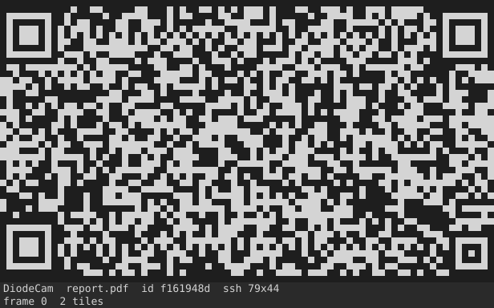
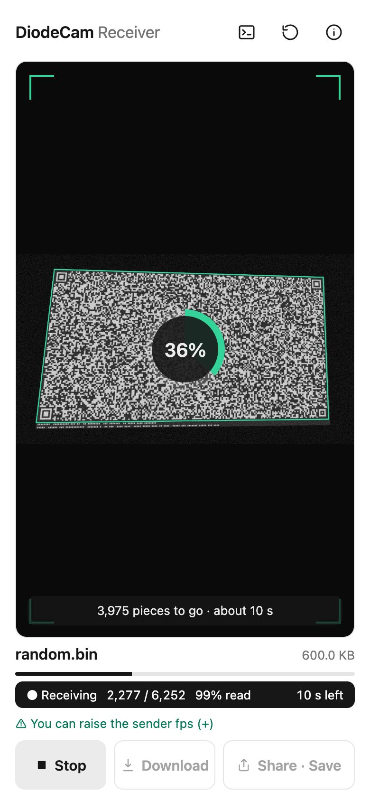
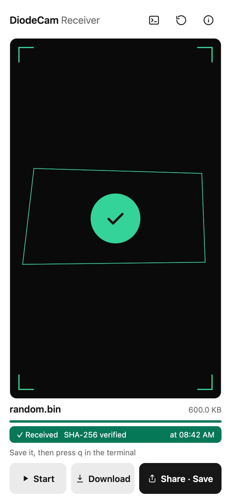
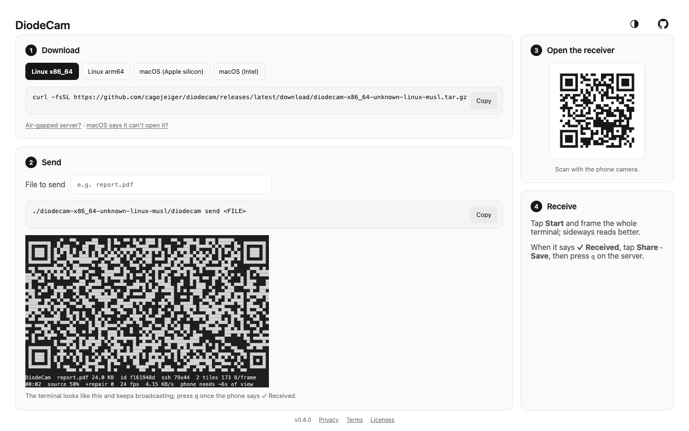

# DiodeCam

Move a file from a terminal to a phone through the camera. One way, offline: no network, no USB, no app to install.

<p align="center">
  
  
  
</p>

## Use

Open **https://cagojeiger.github.io/diodecam/** on a computer. It shows the download command for your server and a QR code for the phone.

<picture>
  <source media="(prefers-color-scheme: dark)" srcset="docs/images/setup-dark.png">
  
</picture>

1. **Download** the sender on the server:
   ```sh
   curl -fsSL https://github.com/cagojeiger/diodecam/releases/latest/download/diodecam-x86_64-unknown-linux-musl.tar.gz | tar xz
   ```
   Other builds: `aarch64-unknown-linux-musl`, `aarch64-apple-darwin`, `x86_64-apple-darwin`.
2. **Send**: `./diodecam-x86_64-unknown-linux-musl/diodecam send <FILE>`. The terminal keeps broadcasting until you press `q`.
3. **Receive**: scan the QR with the phone, tap **Start** and frame the whole terminal. Holding the phone sideways reads better.
4. When it says **✓ Received**, tap **Share · Save**, then press `q` on the server.

Keys while sending: `+`/`-` frame rate, space pause, `q` quit. `diodecam --help` lists the options. Pack a folder with `tar czf` first.

## Speed

24 fps, incompressible data, every tile read (the best case). The grid fills the terminal, so a bigger terminal is faster.

| Terminal | Per second | 1 MiB |
|---|---|---|
| 80×24 | 4.1 KB/s | ~4 min |
| 120×40 | 15 KB/s | ~71 s |
| 200×55 | 41.5 KB/s | ~26 s |

## How it works

```
send:    file → RaptorQ symbols → 128-byte tiles (Reed–Solomon + CRC-32C) → grid of ▀ cells → terminal
receive: camera → find the grid → check each tile → about K + 2 symbols → rebuild → SHA-256 → save
```

The sender repeats fresh repair symbols forever, so a missed frame only costs time: the phone needs about K + 2 symbols (K is the file's symbol count), not particular ones. A damaged tile fails its checks and is dropped, and the rebuilt file must match its SHA-256 before it can be saved.

## Safety

- Moving data out of a restricted network needs your organisation's approval. A camera is an export channel like any other.
- The screen is not encrypted: anyone who can see or film it can receive the file. SHA-256 proves the file arrived intact, not who sent it.
- The receiver uploads nothing and never opens the file; it saves only when you tap Share or Download.
- The page is served from `*.github.io`, whose browser storage is shared with other Pages sites of the same account. For sensitive use, host `web/` on your own HTTPS domain.

## Docs

| | |
|---|---|
| [docs/protocol.md](docs/protocol.md) | The screen format both sides follow |
| [docs/cli.md](docs/cli.md) | The sender |
| [docs/web.md](docs/web.md) | The receiver |
| [docs/development.md](docs/development.md) | Build, test, release |
| [DESIGN.md](DESIGN.md) · [docs/adr/](docs/adr/README.md) | UI rules · why it is built this way |

## License

Apache-2.0. Third-party licenses: [THIRD_PARTY_LICENSES.md](THIRD_PARTY_LICENSES.md).
